# How the model works

In the weeks before the Austrian National Council election on 29 September 2024, I wanted to see if I could build
something better than looking at the last few polls and guessing. The result is a simulation model that uses nothing
but public polls and past election results, and simulates the election 10,000 times down to all 39 regional
electoral districts.

I'm not a political scientist. Everything here uses fairly simple methods: weighted averages, correlations and a lot of
random draws from normal distributions. The point is to show how far that gets you, and to make every step easy to
follow.

All numbers and figures below are from the final run on 27 September 2024.

## Contents

- [How are seats assigned?](#how-are-seats-assigned)
- [Data sources](#data-sources)
- [Model design](#model-design)
- [Turnout](#turnout)
- [National trend](#national-trend)
- [Regional deviation](#regional-deviation)
- [From votes to seats](#from-votes-to-seats)
- [Results](#results)
- [Weaknesses](#weaknesses)
- [How it held up](#how-it-held-up)

## How are seats assigned?

Before building anything, it helps to know what we're actually trying to predict. Austria elects 183 members of the
National Council through a three-tier proportional system
([Nationalratswahlordnung](https://de.wikipedia.org/wiki/Nationalratswahlordnung)):

1. **Regional electoral districts (39).** Each of the nine states has an electoral quota, the *Wahlzahl*: valid votes
   in the state divided by the number of seats it elects. A party wins one seat for every full Wahlzahl it collects in
   a regional district. These are the direct seats (*Grundmandate*).
2. **States (9).** Every party that won at least one direct seat **or** at least 4% of the national vote takes part in
   the second tier. In each state it gets ⌊state votes ÷ Wahlzahl⌋ seats, minus the direct seats it already holds.
3. **Federal.** The remaining seats, up to 183, are distributed nationally using the
   [D'Hondt method](https://en.wikipedia.org/wiki/D%27Hondt_method).

The direct-seat route is why a national model isn't enough. A party with a regional stronghold can, in principle, get
into parliament below 4%. To capture that, the votes have to be simulated **per regional electoral district** and then
added up.

## Data sources

- **Polls:** the poll collection maintained by [@Wahlen_AT](https://twitter.com/Wahlen_AT). It has pollster, client,
  field dates, method and sample size for every published poll. The model uses the 178 polls from January 2023 to
  25 September 2024 that report a sample size.
- **Election results:** the Ministry of the Interior ([BMI](https://www.bmi.gv.at/412/)) publishes official results for
  every federal election down to the municipality level. I use the National Council elections since 2002 and the EU
  elections since 2014.
- **Shapefiles:** the 2024 regional electoral district boundaries from Statistik Austria. These are only used for maps.

## Model design

The model has three components. The first works at the national level, the other two at the regional level:

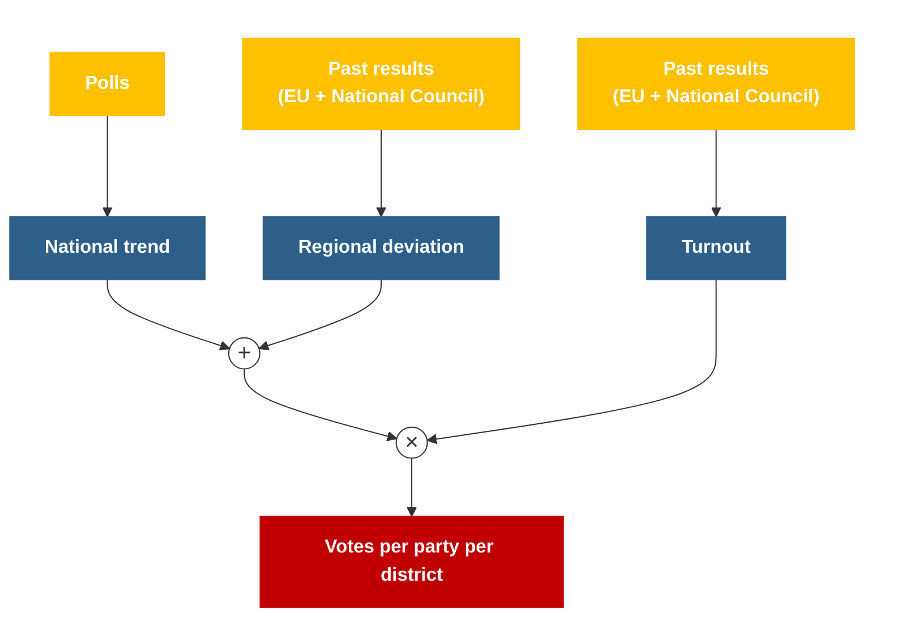

- **National trend + regional deviation** = each party's vote share in a district.
- **× turnout** = how many votes that share is worth.

Each component comes with uncertainty, so each one is simulated rather than fixed. The next three sections go through
them one at a time.

## Turnout

Turnout decides how many votes each district contributes. That matters for the Wahlzahl, for the 4% threshold and for
which party a close seat goes to.

Turnout is not evenly spread across the country, and the pattern is surprisingly stable from election to election.
Here is each district's turnout relative to the national figure:

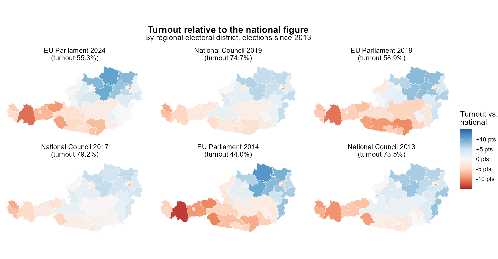

Tirol and Vorarlberg are consistently below the national figure, especially in EU elections. Niederösterreich and
Oberösterreich, the Waldviertel in particular, are consistently above it.

What matters just as much: **districts move together**. When turnout in one district is unusually high relative to the
nation, certain other districts tend to follow. Take Innsbruck:

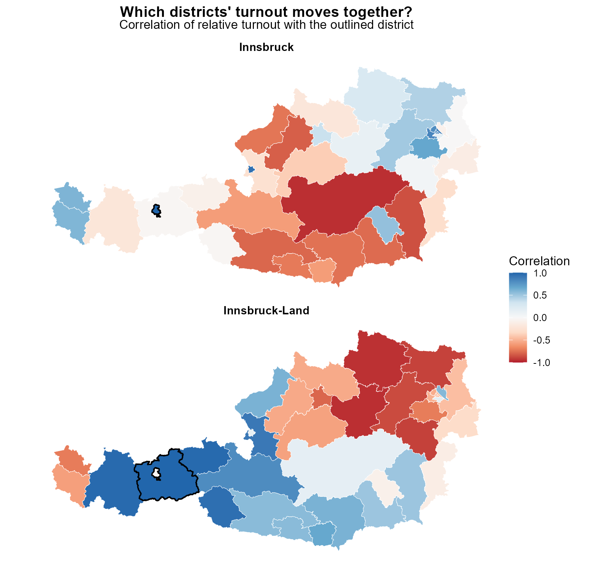

- Innsbruck's relative turnout correlates most strongly with other cities: Salzburg Stadt (0.95), Wien Innen-Ost (0.88),
  Wien Süd-West (0.84) and Wien Innen-Süd (0.82).
- It correlates negatively with rural, industrial districts: Obersteiermark (−0.95), Oststeiermark (−0.86) and
  Hausruckviertel (−0.81).
- Innsbruck-Land, right next door, behaves completely differently. It moves with the rest of rural western Austria.

This is the idea that runs through the whole model: **if things are correlated, simulate them correlated.** Turnout is
simulated in two steps:

1. **National turnout** (valid votes ÷ eligible voters) is drawn from a normal distribution. Its centre is the
   recency-weighted average of past National Council elections, 76.5%.
2. **Each district's deviation** from the national figure is drawn from a multivariate normal distribution. The means
   are each district's weighted historical deviation; the covariance comes from the correlations above.

Add the two together and multiply by the number of eligible voters: that's the number of voters in each district in a
given simulation.

## National trend

The national trend comes from the polls. Not all polls are equal, though, so they can't just be averaged.

Some general rules:

- Polls without a sample size are excluded.
- Newer is better than older.
- More respondents are better than fewer.
- Face-to-face interviews are better than phone, which is better than online-only panels.

That translates into a weight per poll:

| Method | Weight | Polls |
|:---|---:|---:|
| Face-to-face + online | 0.7 | 14 |
| Phone + online | 0.6 | 26 |
| Online only | 0.5 | 138 |

The method weight is multiplied by a recency weight that decays exponentially, e^(−0.02 · days before the forecast). A
poll from two weeks earlier counts about 75% as much as one from forecast day.

Sample size enters through each poll's margin of error, √(p(1−p)/n). The weighted margin of error is used as the
uncertainty around the weighted average:

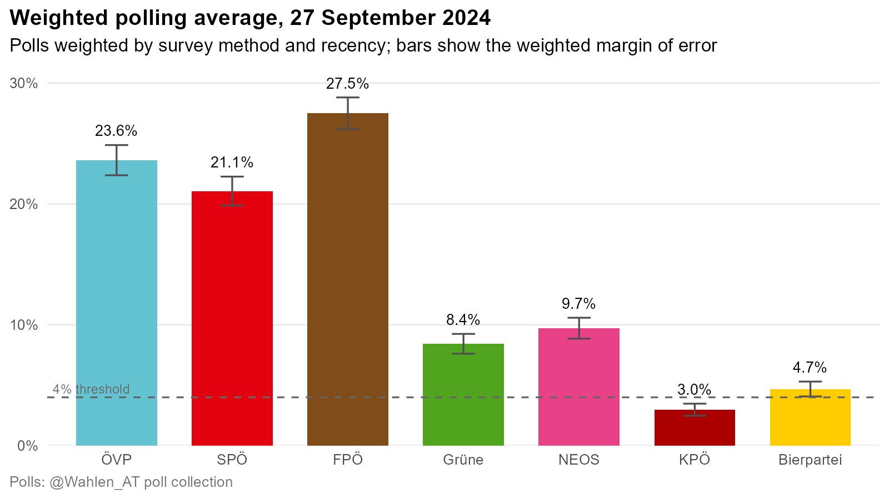

### Monte Carlo

The simplest way to turn this into simulations: draw each party's result from a normal distribution with the polling
average as the mean and the margin of error as the standard deviation, 10,000 times.

That has two problems:

- **It allows impossible results.** Nothing stops all parties together from adding up to well over or under 100%.
- **It ignores how voters actually move.** If ÖVP does better than its polls, those votes have to come from somewhere,
  most likely a party with an overlapping electorate. Independent draws can't represent that.

The fix is the same as with turnout: simulate correlated. The correlations come from how the parties' national vote
shares have moved together across past elections:

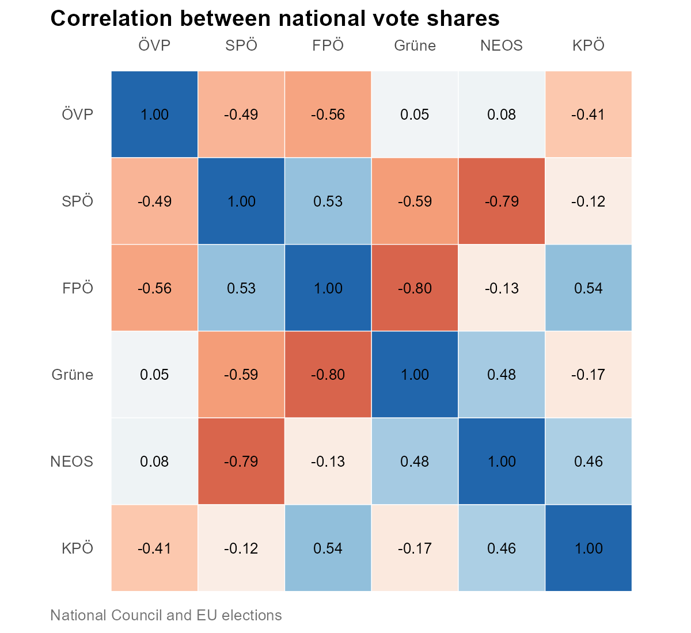

- The diagonal is trivially 1: more votes for ÖVP mean more votes for ÖVP.
- ÖVP–FPÖ at −0.56: when one is up, the other tends to be down. That fits voters moving between the two.
- ÖVP–KPÖ at −0.41: also negative, but there's probably no real voter flow behind it. With only a handful of elections,
  some correlations are coincidence.
- BIER, KEINE and LMP have too little electoral history to estimate anything. They are treated as uncorrelated with
  everyone.

With the correlations in place, the draws respect the trade-offs between parties. Here are ÖVP and FPÖ in 3,000
simulated elections, once drawn independently and once with the correlations:

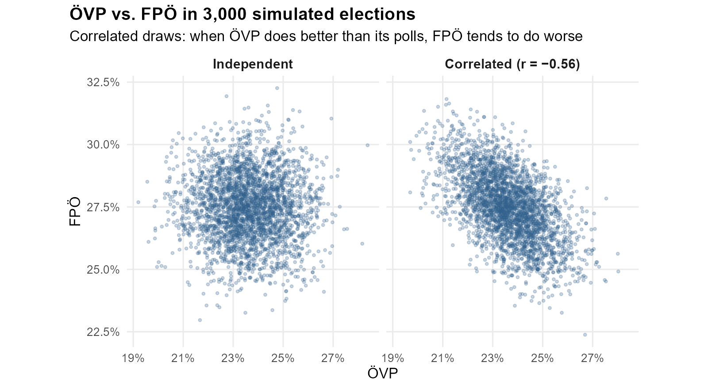

## Regional deviation

Parties don't do equally well everywhere. In the 2019 National Council election, SPÖ got 21.2% nationally, but only 13%
in Tirol and 27.1% in Vienna.

The difference between a party's result in a district and its national result is its **regional swing**:

> regional swing = district result − national result

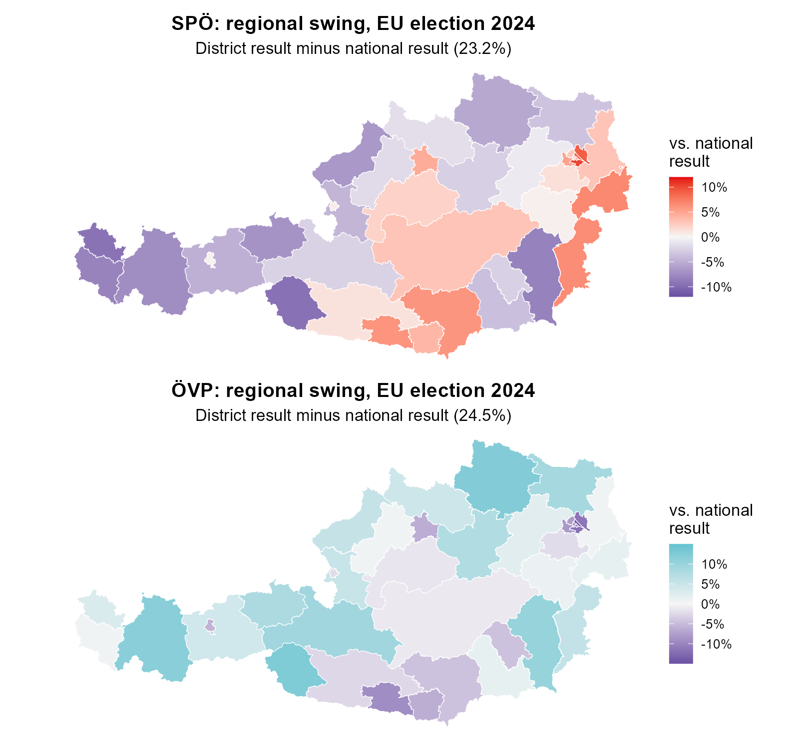

The SPÖ map shows its strongholds in Vienna, Kärnten, the Obersteiermark and Burgenland. ÖVP is close to the mirror
image: strong in the Waldviertel, the Oststeiermark and rural western Austria, weak in Vienna, the other cities and
Kärnten.

To estimate the swing for 2024, I take every election since 2013 and average the swings, giving recent elections more
weight. The regional electoral districts were redrawn before 2013, so earlier elections aren't comparable at this level.
For SPÖ in Innsbruck:

| Election | SPÖ Innsbruck | SPÖ national | Swing (pts) | Weight |
|:---|---:|---:|---:|---:|
| EU 2024 | 23.5% | 23.2% | +0.3 | 1.00 |
| EU 2019 | 19.4% | 23.9% | −4.5 | 0.67 |
| NR 2019 | 16.9% | 21.2% | −4.3 | 0.67 |
| NR 2017 | 28.3% | 26.9% | +1.5 | 0.40 |
| EU 2014 | 18.5% | 24.1% | −5.6 | 0.20 |
| NR 2013 | 19.8% | 26.8% | −7.0 | 0.20 |

That gives a weighted swing of **−2.4 points** with a standard deviation of **3.4 points**. In other words, SPÖ is
expected to do about 2.4 points worse in Innsbruck than nationally, give or take a few points.

New parties (LMP, KEINE) have no history, so they get a swing of zero with a small standard deviation.

### Regional correlations

The same logic applies again. A party doing better than usual in a district means other parties doing worse than usual
there, and which parties trade places differs by region. So for every district I calculate the correlations between
the parties' swings:

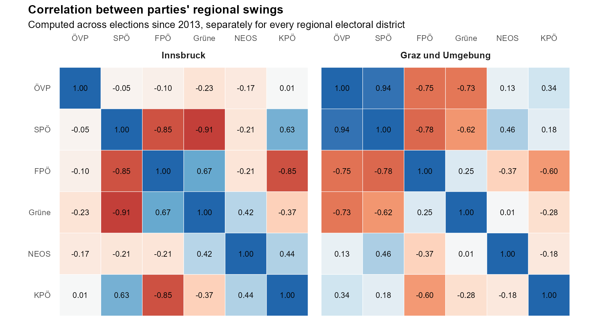

These pick up local political patterns, and they differ a lot from district to district. In Innsbruck, SPÖ's swing
moves against Grüne (−0.91) and FPÖ (−0.85). In Graz und Umgebung, ÖVP and SPÖ move together (0.94), and both move
against FPÖ and Grüne.

In every simulation, each district's swings are drawn from a multivariate normal distribution with these means,
standard deviations and correlations. They are then **added to that simulation's national result**:

> district result = simulated national result + simulated regional swing

## From votes to seats

At this point every simulation has a vote share and a number of voters for every party in every district. Each of the
10,000 simulations then goes through the actual seat allocation:

1. Calculate each state's Wahlzahl from that simulation's votes.
2. Award direct seats in the regional electoral districts.
3. Find the parties that qualify for the second tier (≥ 4% nationally or at least one direct seat) and award their
   state seats.
4. Distribute the remaining seats up to 183 with D'Hondt.

The output is 10,000 complete parliaments.

## Results

The results come with a clear caveat. The model is only as good as the polls going into it, and it has several known
simplifications (see [Weaknesses](#weaknesses)).

Nationally, summed up from all 39 districts:

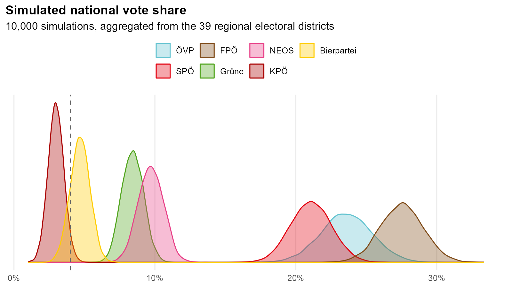

| Party | Median | 5th percentile | 95th percentile |
|:---|---:|---:|---:|
| FPÖ | 27.5% | 25.0% | 30.0% |
| ÖVP | 23.6% | 20.6% | 26.6% |
| SPÖ | 21.1% | 18.7% | 23.5% |
| NEOS | 9.7% | 8.3% | 11.2% |
| Grüne | 8.4% | 7.2% | 9.7% |
| Bierpartei | 4.7% | 3.5% | 5.8% |
| KPÖ | 3.0% | 2.1% | 3.9% |

Since everything is simulated at the district level, the same output can be shown for any region. Tirol, for example,
has five regional electoral districts, and they look very different from each other:

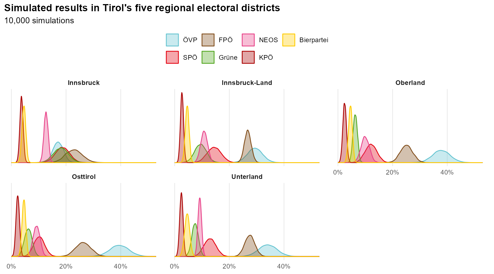

In Oberland, Osttirol and Unterland ÖVP is clearly ahead. In Innsbruck-Land it's close between ÖVP and FPÖ. In Innsbruck
itself, FPÖ is narrowly ahead of a three-way race between ÖVP, SPÖ and Grüne.

The seats:

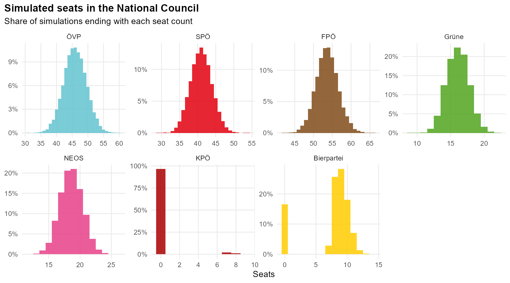

The interesting cases are at the threshold. The Bierpartei entered parliament in 84% of simulations. When it did, it got
around 7–12 seats, since 4% of the vote is worth about 7 seats. KPÖ made it in only 3% of simulations.

Which coalitions would have a majority (92 of 183 seats), and in what share of the simulations?

| Coalition | Median seats | Majority in |
|:---|---:|---:|
| ÖVP + SPÖ + NEOS | 105 | 100.0% |
| FPÖ + ÖVP | 99 | 99.8% |
| ÖVP + SPÖ + Grüne | 103 | 99.8% |
| ÖVP + SPÖ | 87 | 5.0% |
| ÖVP + Grüne + NEOS | 81 | 2.5% |
| SPÖ + Grüne + NEOS | 75 | 0.0% |

Three coalitions are near-certain to have a majority; everything else is a long shot.

## Weaknesses

The biggest lever is the polling average:

- **The quality criteria are crude.** Three method categories and a decay rate are a rough proxy for pollster quality.
  A proper pollster rating based on past accuracy would be better.
- **There is too little uncertainty.** The margin of error only covers sampling error. Real polling misses are shared
  across pollsters and have fatter tails, especially for new parties. The simulation should have more spread.
- **Polls are not votes.** Strategic voting and the gap between telling a pollster you'll vote for a party and actually
  doing so aren't modelled. Small new parties are the most exposed to this.

On the regional side:

- **The swing is additive.** A party that is 16 points below its national result in a district is assumed to stay 16
  points below, even when its national result changes a lot. Modelling the swing proportionally would behave better
  for parties with a low share in a region.
- **New parties are a blank.** Zero swing and zero correlation for BIER, LMP and KEINE is a placeholder, not an
  estimate. They could borrow patterns from ideologically similar parties.
- **The correlations rest on few elections.** Six elections per district is a small sample for a correlation matrix.

## How it held up

The forecast was frozen on 27 September 2024, two days before the election. 8 of 9 parties landed inside their 90%
interval. SPÖ (21.1% forecast, 21.1% actual), Grüne and NEOS were within a point, and turnout was forecast at 76.5%
against an actual 76.9%. The clear miss was the Bierpartei: it polled at 4.7% and got 2.0%. In the real parliament, the seats
the model had given it went to ÖVP and FPÖ, both of which the polls had underestimated.

The full comparison, including a district-by-district breakdown, is in **[POSTMORTEM.md](POSTMORTEM.md)**.
