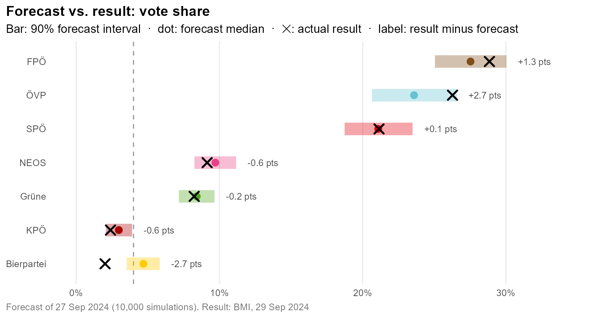
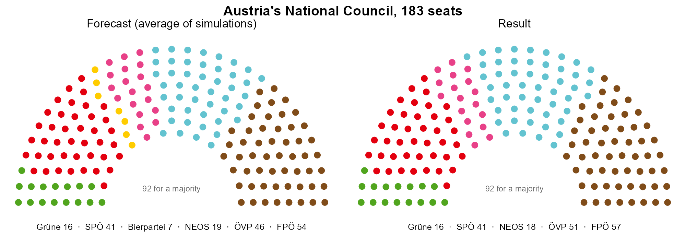
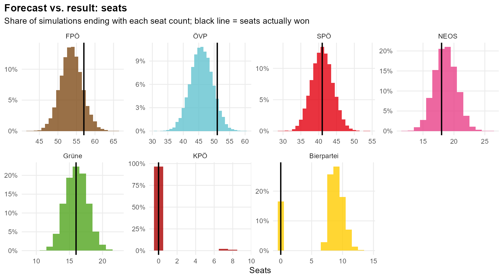
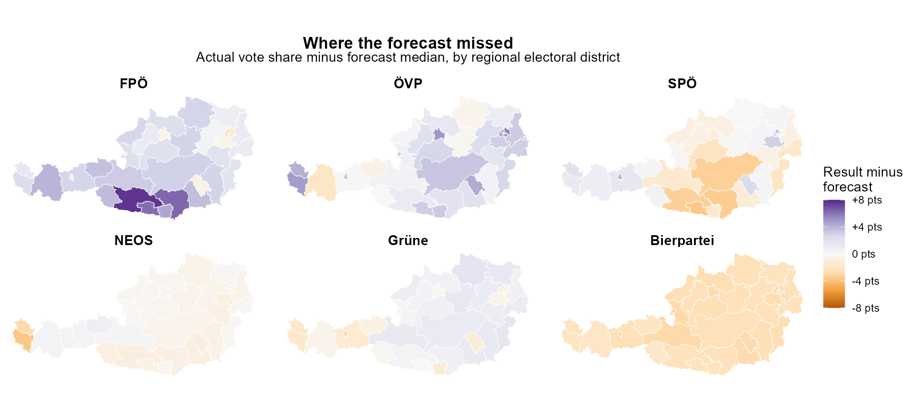

# Post-mortem: forecast vs. result

The final forecast was run on 27 September 2024, two days before the election. This page compares it with the official
result, as certified by the Federal Electoral Board on 16 October 2024. How the model works is explained in
[MODEL.md](MODEL.md).

## National

| Party | Forecast | 5th pct. | 95th pct. | Result | Forecast seats | Seats won |
|:---|---:|---:|---:|---:|---:|---:|
| FPÖ | 27.5% | 25.0% | 30.0% | 28.8% | 54 | 57 |
| ÖVP | 23.6% | 20.6% | 26.6% | 26.3% | 46 | 51 |
| SPÖ | 21.1% | 18.7% | 23.5% | 21.1% | 41 | 41 |
| NEOS | 9.7% | 8.3% | 11.2% | 9.1% | 19 | 18 |
| Grüne | 8.4% | 7.2% | 9.7% | 8.2% | 16 | 16 |
| KPÖ | 3.0% | 2.1% | 3.9% | 2.4% | 0 | 0 |
| Bierpartei | 4.7% | 3.5% | 5.8% | 2.0% | 9 | 0 |

8 of 9 parties landed inside their 90% interval. SPÖ, Grüne and NEOS were within a point, and their seat counts
were exact or one seat off. Turnout (valid votes ÷ eligible voters) was forecast at 76.5% (73.8–79.3%); the actual
figure was 76.9%.

ÖVP and FPÖ were both underestimated, by 2.7 and 1.3 points. The polls shared that miss.

**The Bierpartei was the big miss.** It polled at 4.7% and entered parliament in 84% of simulations. It got 2.0%, lower
than all but one of the 10,000 simulations. Support for new, protest-flavoured parties often doesn't fully turn out on
election day, and the model had no mechanism for that.

## Seats

With about 9 Bierpartei seats in a typical simulation, every other party's seat count was deflated. In the real
parliament those seats went to ÖVP (+5 vs. the forecast median) and FPÖ (+3).

That had a direct effect on the coalition picture. ÖVP + SPÖ won exactly 92 seats, a bare majority, but the forecast
gave that combination only a 5% chance. The government eventually formed was ÖVP + SPÖ + NEOS (110 seats), which had a
majority in 100% of simulations.

## Districts

With 90% intervals you'd expect about 90% of districts to contain the actual result:

| Party | Mean abs. error (pts) | Mean error (pts) | Districts inside 90% interval |
|:---|---:|---:|---:|
| ÖVP | 2.7 | +2.5 | 62% |
| SPÖ | 1.8 | +0.3 | 82% |
| FPÖ | 2.6 | +1.4 | 67% |
| Grüne | 1.3 | −0.3 | 97% |
| NEOS | 0.7 | −0.6 | 95% |
| KPÖ | 0.7 | −0.5 | 90% |
| Bierpartei | 2.7 | −2.7 | 0% |

*Forecast = median of the simulations. Mean error = result minus forecast.*

At the district level the model was overconfident for the two parties the polls missed. Much of that is the national
miss carried into every district, but the misses also have a geography. FPÖ beat its forecast by 6–8 points in
Kärnten, and ÖVP did up to 6 points better than expected in Vienna:

The Vienna miss is a direct consequence of the additive swing. ÖVP's historical swing in Wien Innen-Ost is about −16
points. Applied to a national forecast of 23.6%, that left ÖVP at 7.8% in the district. It got 13.8%. A proportional
swing would have shrunk along with ÖVP's national share.

## What I'd change

These are in addition to the weaknesses listed in [MODEL.md](MODEL.md#weaknesses):

1. **Proportional or logit-scale regional swing**, for the reason above.
2. **A shared polling-error term** with fatter tails, plus a discount for new parties' poll numbers.
3. **Backtesting on 2017 and 2019**, to check whether the intervals are calibrated before an election rather than after.

The numbers on this page come from `scripts/05_postmortem.R`. The tables are in `output/postmortem.csv`,
`output/district_postmortem.csv` and `output/district_coverage.csv`.
